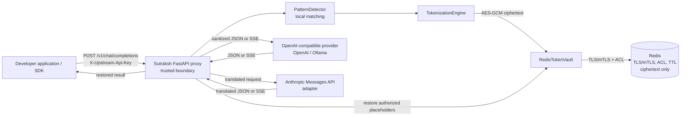

# Sutraksh Architecture and Design Specification

**Audience:** developers, reviewers, and AI coding assistants taking over the project

**Product:** Sutraksh — AI Security & Governance Infrastructure

**Tagline:** Built in India. Securing AI Everywhere.

**PyPI distribution:** `aegis-privacy-proxy`; 0.1.0 is published, and the current source metadata is 0.1.1 (not published by this task)

**Python import namespace:** `aegismcp` (retained for compatibility)

**Preferred CLI:** `sutraksh` (`aegismcp` remains an alias)

**Status:** Phase 1 alpha; this document describes the code currently in the repository

## 1. Purpose

Sutraksh is a local, OpenAI-compatible proxy that detects selected secrets and personal data in chat messages, replaces matches with placeholders before sending a request to an upstream model, and restores mapped values in the response inside the proxy. Redis stores only encrypted, short-lived mappings.

The project was rebranded without renaming the already-published PyPI distribution, import namespace, Redis ACL identity/key namespace, or the legacy CLI command. New configuration uses the `SUTRAKSH_` prefix; existing `AEGIS_` and documented generic settings continue to work as fallbacks.

The intended deployment boundary is a trusted proxy process running in the developer's environment or a controlled private service boundary. The proxy, its configuration, encryption keys, Redis connection, and any values restored into responses are trusted. The upstream model receives the sanitized request.

This release implements the tokenization and proxy portion of Phase 1. It does **not** implement an MCP tool-call firewall, tool policy engine, human approval flow, or MCP audit service.

## 2. System context



The actual gateway creates a new random request session ID for each chat completion request. A session is therefore request-scoped in the current proxy, even though the lower-level token engine and vault accept an explicit session ID. Conversation-wide mapping continuity is not implemented.

## 3. Repository map

| Path | Responsibility |
| --- | --- |
| `proxy_server.py` | FastAPI app and route, environment-based engine creation, provider URL/auth handling, Anthropic request/response translation, JSON restoration, SSE parsing and placeholder buffering. |
| `aegismcp/cli.py` | Preferred `sutraksh proxy` command and backward-compatible `aegismcp proxy` alias; starts Uvicorn. |
| `aegismcp/config.py` | Resolves new `SUTRAKSH_` settings before legacy `AEGIS_` and generic aliases. |
| `aegismcp/detectors.py` | Local rule-based detection, optional Presidio integration, known-name and custom-regex support. |
| `aegismcp/engine.py` | Applies detections, assigns placeholders, writes mappings before forwarding, and restores placeholders through the vault. |
| `aegismcp/crypto.py` | AES-256-GCM encryption/decryption for vault values. |
| `aegismcp/redis_vault.py` | Redis adapter: validates token scope, derives opaque Redis keys, encrypts values, sets TTL atomically, and decrypts on lookup. |
| `aegismcp/vault.py` | Thread-safe in-memory TTL vault for tests and mock flows; values are plaintext and it is not for production use. |
| `docker-compose.yml`, `docker/redis.conf` | Local Redis development configuration and opt-in integration-test service. |
| `docker/users.acl.example` | Public placeholder ACL example. Replace the placeholder hash locally; never commit generated ACL credentials. |
| `scripts/prepare_live_redis.py` | Generates local Redis credentials and TLS material for development. Generated files are ignored by Git. |
| `examples/chat_test.py` | Local mock-upstream demonstration using a fake key; does not call a real model provider. |
| `tests/` | Detector, token engine, vault, proxy, streaming, mocked provider, and opt-in live Redis tests. |
| `pyproject.toml` | Distribution metadata (`aegis-privacy-proxy`), dependencies, extras, and both console entry points. |

## 4. Request and response flow

### 4.1 Request ingress

1. The proxy accepts `POST /v1/chat/completions` with a JSON object containing a `messages` array. Requests larger than 2 MiB are rejected.
2. The proxy reads the upstream credential from `X-Upstream-Api-Key`. It does not forward the incoming `Authorization` or cookies. OpenAI and Anthropic require this header; Ollama does not.
3. In `enforce` mode, the proxy recursively gathers string values under `messages`, joins them with a generated NUL-delimited separator, and detects sensitive spans locally. It writes replacements back into their original JSON string positions. Other request fields, such as model and sampling settings, are preserved.
4. For each match, the engine creates a marker such as `[EMAIL_01]` or `[API_KEY_01]`. Repeated identical `(entity kind, value)` pairs share a marker within one request. Counters restart for every request.
5. Each unique mapping is persisted to the vault before sanitized content can be forwarded. A vault or encryption failure blocks the request.
6. The proxy sends only the sanitized JSON to the selected upstream. Redirects are disabled. HTTPS is required except for loopback HTTP endpoints, which supports local Ollama and test servers.

### 4.2 Non-streaming response

The proxy parses the upstream JSON response and recursively scans its string values for recognized placeholder syntax. It looks up each marker under the same request tenant and session, then replaces it with the original value. If a marker is unknown, expired, out of scope, or cannot be decrypted, the proxy withholds the response and returns an error instead of returning unresolved or unauthorized data.

Restoration applies to placeholder strings in the upstream response. This is not a general output-side PII detector: new sensitive content invented by the model is not automatically detected or redacted.

### 4.3 Streaming response

With `stream: true`, the proxy opens the upstream response as SSE and translates supported events into OpenAI-compatible SSE chunks. It handles content deltas and tool-argument deltas. A per-stream buffer retains a suffix that could be an incomplete placeholder (for example, `[API_KEY_`), up to 128 characters. Complete placeholders are looked up and restored; unresolved markers or malformed/incomplete marker fragments terminate the stream with a security error event. The proxy emits `data: [DONE]` at completion.

Before opening the upstream stream, the proxy resolves all placeholders found in the sanitized request as a preflight check. The resulting values are not cached for stream processing: when a complete placeholder arrives in a response delta, the current streaming restorer looks it up through the engine and vault again. A Redis failure or mapping expiry after streaming starts can therefore terminate the stream. Once headers have been sent, the proxy cannot change the HTTP status to 500; clients must handle a stream error event or early termination.

## 5. Provider interface

The only public ingress route is OpenAI chat-completions compatible: `POST /v1/chat/completions`. `GET /healthz` returns a basic process health response; it does not check Redis or the configured provider.

| Provider | Upstream behavior |
| --- | --- |
| `openai` | Forwards the chat-completions payload to `/v1/chat/completions` (or `/chat/completions` if the configured base URL already ends in `/v1`) using `Authorization: Bearer …`. |
| `ollama` | Uses the same OpenAI-compatible chat-completions route. Local unauthenticated endpoints are supported. |
| `anthropic` | Translates the supported OpenAI chat subset to Anthropic's `/v1/messages`, authenticates using `x-api-key`, and translates JSON/SSE responses back to the OpenAI-compatible shape. This is an upstream adapter, **not** a native Anthropic SDK ingress route; `/v1/messages` is not exposed by Sutraksh. |

Anthropic translation covers common text messages, system/developer text, function tools/tool choice, sampling settings, and stop sequences. Unsupported shapes are rejected. Provider-specific advanced features are not guaranteed to translate losslessly.

## 6. Detection and tokenization

The default `PatternDetector` runs locally and offline. Its rule set includes common provider keys and tokens, bearer/basic credentials, JWTs, private-key blocks, labeled secrets and passwords, URL credentials, selected financial and government identifiers, email, phone, IP/MAC addresses, and labeled dates/addresses. Checksums are used for card and IBAN validation. Exact known names and organization-specific regexes can be supplied through the Python API.

Optional `presidio` mode adds a local English Presidio analyzer and spaCy model. It must be installed locally and selected with `SUTRAKSH_PII_ENGINE=presidio` (legacy: `AEGIS_PII_ENGINE`); it does not send text to a hosted detection service. Optional NER expands coverage, but neither it nor regex patterns detect every sensitive fact. False positives and false negatives are expected; this project is not a DLP guarantee.

### Placeholder format

`[<ENTITY_KIND>_<2+ digit ordinal>]`, for example `[PHONE_01]`. Entity kinds are uppercase and bounded to 48 characters. The placeholder preserves where a value appeared but does not reveal the original value to the model. A model is not required to preserve placeholders exactly, so callers should test prompts and responses relevant to their workflow.

## 7. Vault and cryptographic design

### Redis-backed vault

- `MappingCipher` requires a 32-byte AES-256 key and uses AES-GCM with a fresh random 12-byte nonce for every write. The nonce is prefixed to the ciphertext; GCM authentication tag verification occurs during decryption.
- Scope data consists of tenant ID, request session ID, and token. The scope is passed as AES-GCM associated data, binding ciphertext to that scope.
- Redis key names are HMAC-SHA256 digests over the scope using a separate index key. Redis does not see raw tenant/session/token identifiers in key names.
- Every write uses a single Redis `SET ... EX <ttl>` operation. TTL is constrained to 300–900 seconds, defaulting to 600 seconds. Redis stores ciphertext only.
- The configured Redis client requires TLS certificate verification and client certificates. There is no plaintext fallback.
- Local Redis is configured with RDB snapshots disabled (`save ""`), AOF disabled, no volume for Redis data, ACL authentication, and a loopback-only host port. The Redis container listens within its private Compose network. This Compose setup is for local development, not a production deployment template.

The in-memory vault intentionally stores plaintext and is suitable only for tests/mock flows. It must not be selected as a production substitute for Redis. It uses a shorter five-minute TTL by default.

### Key handling

The proxy reads AES and HMAC index keys from environment variables (or a local `.env.redis` file for development). Production should inject them through an appropriate secret manager and define a rotation and recovery plan. Do not commit `.env.redis`, generated ACLs, private keys, certificates, or real provider credentials. Key zeroization is not guaranteed by Python's memory model.

## 8. Modes and failure behavior

| Mode | Behavior |
| --- | --- |
| `enforce` (default) | Tokenizes before forwarding. Vault/encryption/configuration failures block the request; restoration failures withhold the response. |
| `warn` | Detects and logs only the count and entity kinds, then forwards the original content unchanged. This mode does not protect data and should be used only with synthetic prompts. |

Logs are designed to avoid prompt and matched-value content. Errors report failure categories rather than sensitive payloads. The proxy maps invalid input/configuration, missing credentials, upstream errors/timeouts, and security failures to HTTP errors. After a stream starts, a security failure is represented as an SSE error because the HTTP status is already committed. The SSE error type `aegismcp_security_error` remains unchanged as a wire-level compatibility identifier.

## 9. Configuration reference

`sutraksh proxy` accepts `--host`, `--port`, `--upstream-base-url`, `--provider`, `--mode`, `--env-file`, and `--reload`. `aegismcp proxy` remains an alias. New settings use `SUTRAKSH_`; where an old `AEGIS_` variable or generic alias existed, it is still accepted with lower precedence. If both new and old names are set, `SUTRAKSH_` wins.

| Setting | Purpose | Default |
| --- | --- | --- |
| `SUTRAKSH_PROXY_HOST` / `--host` | Bind address (legacy: `AEGIS_PROXY_HOST`). | `127.0.0.1` |
| `SUTRAKSH_PROXY_PORT` / `--port` | Bind port (legacy: `AEGIS_PROXY_PORT`). | `8000` |
| `SUTRAKSH_UPSTREAM_BASE_URL` / `--upstream-base-url` | Provider base URL (legacy: `AEGIS_UPSTREAM_BASE_URL`). | Required |
| `SUTRAKSH_UPSTREAM_PROVIDER` / `--provider` | `openai`, `anthropic`, or `ollama` (legacy: `AEGIS_UPSTREAM_PROVIDER`). | `openai` |
| `SUTRAKSH_MODE` / `--mode` | `enforce` or `warn` (legacy: `AEGIS_MODE`). | `enforce` |
| `SUTRAKSH_ENV_FILE` / `--env-file` | Development env file path (legacy: `AEGIS_ENV_FILE`). | `.env.redis` |
| `SUTRAKSH_TENANT_ID` | Static configured tenant scope (legacy: `AEGIS_TENANT_ID`). | `local-dev` |
| `SUTRAKSH_PII_ENGINE` | `pattern` or `presidio` (legacy: `AEGIS_PII_ENGINE`). | `pattern` |
| `SUTRAKSH_AES_KEY_B64` | Base64-encoded 32-byte AES key (legacy: `AEGIS_AES_KEY_B64`, `AES_KEY_B64`). | Required in enforce mode |
| `SUTRAKSH_INDEX_KEY_B64` | Base64-encoded HMAC index key, at least 32 bytes (legacy: `AEGIS_INDEX_KEY_B64`, `INDEX_KEY_B64`). | Required in enforce mode |
| `SUTRAKSH_VAULT_TTL_SECONDS` | Redis mapping TTL, 300–900 seconds (legacy: `AEGIS_VAULT_TTL_SECONDS`). | `600` |
| `SUTRAKSH_REDIS_HOST`, `SUTRAKSH_REDIS_PORT` | Redis address (legacy: `AEGIS_REDIS_*`, `REDIS_*`). | `127.0.0.1:6380` |
| `SUTRAKSH_REDIS_USERNAME`, `SUTRAKSH_REDIS_PASSWORD` | Redis ACL identity (legacy: `AEGIS_REDIS_*`, `REDIS_*`). Username and ACL key namespace remain compatible with existing deployments. | Required in enforce mode |
| `SUTRAKSH_REDIS_TLS_DIR` | Directory containing default CA/client cert/key (legacy: `AEGIS_REDIS_TLS_DIR`). Individual `SUTRAKSH_REDIS_CA_CERTS`, `SUTRAKSH_REDIS_CLIENT_CERT`, and `SUTRAKSH_REDIS_CLIENT_KEY` paths can override it. | `secrets/redis-tls/` |
| `SUTRAKSH_ANTHROPIC_VERSION`, `SUTRAKSH_ANTHROPIC_DEFAULT_MAX_TOKENS` | Anthropic adapter defaults (legacy: `ANTHROPIC_VERSION`, `ANTHROPIC_DEFAULT_MAX_TOKENS`). | API version `2023-06-01`; max tokens `1024` |
| `X-Upstream-Api-Key` | Per-request real provider key. | Required for OpenAI and Anthropic; optional for Ollama |

Never put a real upstream credential in the OpenAI SDK's `api_key` argument for this proxy. The SDK requires a placeholder value; the real key belongs in `X-Upstream-Api-Key`, which the proxy consumes and replaces with the provider's expected authentication header.

## 10. Testing and local development

```powershell
python -m pip install -e ".[test]"
python -m pytest
```

Most tests use fake values, an in-memory vault, and mocked upstreams; they make no real OpenAI or Anthropic API calls. The live TLS Redis test is opt-in and runs with:

```powershell
docker compose up -d
docker compose --profile test run --rm redis-test
```

The mock user demo requires a running proxy configured against its local mock upstream and never contacts a real model. Published package installation is `python -m pip install aegis-privacy-proxy`; the preferred command is `sutraksh proxy`, with `aegismcp proxy` retained as an alias. The Python import package remains `aegismcp`.

## 11. Current boundaries and production gaps

These are intentional handoff notes, not promises that the capability already exists:

1. **No MCP firewall yet.** There is no MCP server/client interception, tool allow/deny policy, tool pinning, approval workflow, or tool-call audit log.
2. **No caller authentication or tenant resolver.** `SUTRAKSH_TENANT_ID` (legacy: `AEGIS_TENANT_ID`) is a static process setting, defaulting to `local-dev`. The proxy does not authenticate callers or infer a tenant from a trusted identity provider. Do not expose it to multiple users without adding authenticated identity middleware and a trusted tenant mapping.
3. **Request-scoped mappings only.** The proxy generates a fresh session ID per request. Placeholders are not stable across turns of a conversation. The Redis adapter supports session scoping, but cross-request conversation management and explicit session lifecycle endpoints are not implemented.
4. **Detection is incomplete.** Default regex rules are experimental; NER is English-only as configured. New names, contextual combinations, proprietary identifiers, and unsupported formats may pass through. Output-side detection of newly generated sensitive content is not implemented.
5. **Streaming has inherent post-header limits.** A failure after SSE delivery begins cannot return an HTTP 500. Clients need to treat security SSE errors and incomplete streams as failed completions.
6. **Local Redis topology is a development example.** Production needs a private network, reviewed Redis sizing/availability policy, managed secrets/keys, operational monitoring, backup policy consistent with the no-persistence objective, and tested rotation/recovery.
7. **Health endpoint is shallow.** `/healthz` reports that the HTTP process answered; it does not verify Redis, encryption keys, or upstream reachability.
8. **No live provider guarantee.** Automated provider tests use mocks. An OpenAI-compatible adapter or the Anthropic translation does not certify compatibility with every provider feature or API revision.

## 12. Extension guidance for future contributors

- Keep detection, tokenization, encryption, Redis storage, provider translation, and routing as separate responsibilities.
- Never pass raw prompt strings to logs, metrics labels, exception messages, or tracing attributes.
- Add a detector rule with positive and negative fixtures; prefer validators/checksums or labels where numeric formats are ambiguous.
- Keep Redis writes atomic with TTL and scope-bound encryption. Do not add a plaintext fallback.
- Treat unknown or unauthorized placeholders as errors. In enforce mode, fail closed before forwarding or before delivering the affected response content.
- Add tests for both JSON and SSE where a behavior affects both. SSE tests should split placeholders at arbitrary boundaries and cover tool arguments, stream termination, and vault failures.
- Keep user-facing docs explicit about mocked tests versus real provider calls, the current endpoint compatibility, and remaining security limitations.

## 13. High-level design decisions

| Decision | Reason |
| --- | --- |
| OpenAI-compatible ingress | Lets supported clients change their base URL while the proxy owns sanitization and upstream auth. |
| Local detection | Raw prompts do not need to be sent to a hosted detection service. |
| Placeholder substitution instead of removal | Preserves structure and lets the model refer to sensitive values without receiving them. |
| AES-GCM plus HMAC-derived Redis keys | Redis contains authenticated ciphertext and opaque scope keys, not plaintext values or descriptive identifiers. |
| Short TTL with atomic Redis expiry | Bounds mapping lifetime and avoids a write-without-expiration gap. |
| Fail-closed enforce mode | Prevents vault/encryption errors from silently forwarding raw content or returning unresolved data. |
| Optional Presidio extra | Keeps the default install lighter and offline while allowing additional local NER coverage. |
